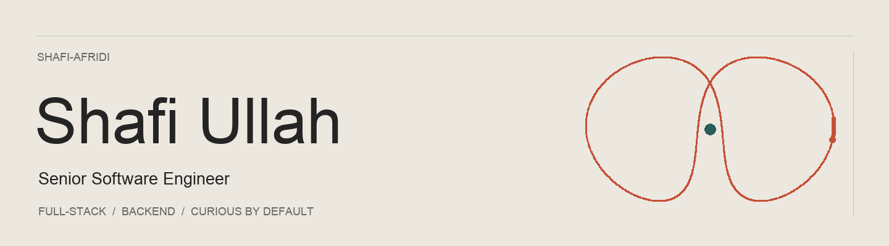

  <a href="https://www.shafiullah.dev/">Portfolio</a> &nbsp; / &nbsp;
  <a href="https://www.linkedin.com/in/shafi-ullah-afridi-2976b5189/">LinkedIn</a> &nbsp; / &nbsp;
  <a href="mailto:shafistacks@gmail.com">Email</a>

### A little about me

I build across the stack, with a focus on backend systems, useful interfaces and the details that make software dependable. My work spans healthcare, senior living and financial integrations.

I like staying with a problem from the first technical decision through release: working with product and QA, testing connected workflows, and making the next change easier to understand.

Away from the day job, I explore Python, on-device machine learning and small tools that make everyday work simpler. Always collecting good ideas.

### Tools I reach for

| Area | Toolkit |
| :--- | :--- |
| Languages | TypeScript · JavaScript · Python · PHP |
| Interfaces | React · Angular · Vue · Next.js |
| Backend & data | Node.js · Express · PostgreSQL · MySQL · Redis · RabbitMQ |
| Cloud & delivery | AWS · Docker · Pulumi · AWS CDK · GitHub Actions |
| Quality | Mocha · Chai · Sinon · Unit & integration testing |

More about my work at **[shafiullah.dev](https://www.shafiullah.dev/)**.
